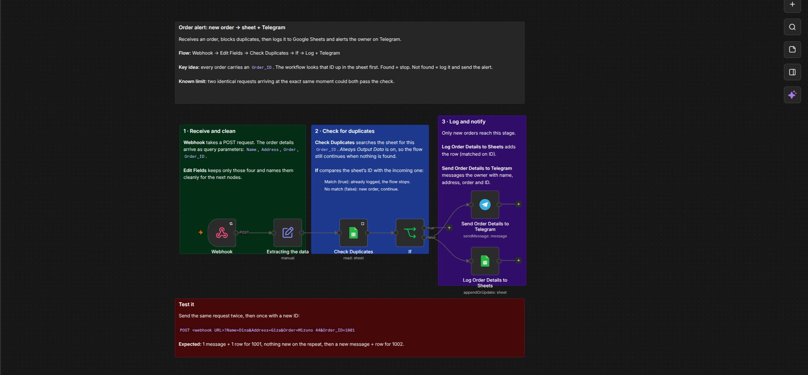

# Order alert — new order → log + Telegram ping

A small n8n workflow that turns a new order into a row in a log and an instant Telegram
message to the shop owner. Built and tested against a fake webhook, so it can be tried
without touching a live store.



- **Workflow file:** [`workflow/orders-monitoring-and-alerts.json`](workflow/orders-monitoring-and-alerts.json)
- **Demo recording:** [`media/demo.mp4`](media/demo.mp4) (60–90s: send, receive, repeat, new ID)
- **Canvas screenshot:** [`media/workflow-canvas.png`](media/workflow-canvas.png)

---

## The problem

A small Egyptian COD shop takes orders through a website form and Meta ads. The owner
finds out about an order when he happens to open the admin — and when he *does* get a
notification, the same order often pings him twice (form re-submit, webhook retry, or a
double-click on "Test"). Slow alerts cost confirmations; duplicate alerts train him to
ignore the channel. The job here is narrow: **tell him once, immediately, with the details
he needs to call the customer back.**

## How it works

```
Webhook → Extracting the data → Check Duplicates → If → Log to Sheets + Telegram
```

| Node | What it does |
|---|---|
| **Webhook** | Receives `POST` with `Name`, `Address`, `Order`, `Order_ID` as query params. Responds immediately. |
| **Extracting the data** (Edit Fields) | Keeps only those four fields and names them cleanly for later nodes. |
| **Check Duplicates** (Google Sheets, *Get rows*) | Looks up the incoming `Order_ID` in the log sheet. *Always Output Data* is on so the flow continues when nothing is found. |
| **If** | `ID` (from the sheet) equals the incoming `Order_ID` → **true** = already logged, stop. No match → **false** = new order, continue. |
| **Log Order Details to Sheets** | Appends the row, matched on `ID` (so a repeat updates instead of duplicating). |
| **Send Order Details to Telegram** | Messages the owner: name, address, order and ID. |

The continuing branch is **false** (no match). On it, the order is **logged first, then
notified**, so a failed Telegram call never loses the order.

### Test it

```bash
# new order -> 1 message + 1 row
curl -X POST "<WEBHOOK_URL>?Name=Dina&Address=Giza&Order=Mizuno 44&Order_ID=1001"

# same ID again -> nothing happens
curl -X POST "<WEBHOOK_URL>?Name=Dina&Address=Giza&Order=Mizuno 44&Order_ID=1001"

# new ID -> a second message + row
curl -X POST "<WEBHOOK_URL>?Name=Omar&Address=Cairo&Order=Asics 43&Order_ID=1002"
```

Expected: one alert and one row for `1001`, silence on the repeat, then a new alert and row
for `1002`.

### Verified (31 Oct 2026)

From the n8n execution log:

| Execution | Incoming `Order_ID` | Path taken | Result |
|---|---|---|---|
| 1259 | `1001` (already logged) | If → **true** | stopped at the check, no alert |
| 1260 | `1002` (new) | If → **false** | Telegram sent, sheet row added |
| 1261 | `999999` (new) | If → **false** | Telegram sent, sheet row added |

The duplicate (`1001`) was blocked on the true branch — that is the whole point of the
workflow working.

## Known limitation

The duplicate check is **read-then-write, so it is not atomic.** Two identical requests
arriving at the *exact same moment* can both read "not found" before either writes, and
both proceed. In practice this is rare, but Shopify retries and double-submits are exactly
the kind of bursts that cause it. The durable fix is to let the log enforce uniqueness
(a sheet `Order_ID` unique check, or a database unique index / `INSERT ... ON CONFLICT`),
or to add an idempotency key in the workflow itself.

Secondary limits, all acceptable for a pilot: the payload arrives as **query params** (real
Shopify data will need mapping), there is no retry on the Telegram node, and the sheet is
the single source of truth.

## What I'd build next

1. **Swap the Webhook for a Shopify Trigger** (`orders/create`) and map real order JSON —
   this is the actual production change.
2. **Make dedupe atomic** — unique key on `Order_ID` so the check can't race.
3. **Low-stock alert** — same pattern on `inventory_levels/update`: ping when a variant
   drops below a threshold.
4. **Status flow** — move `new → notified → confirmed → refused`, so the owner can work
   the order from one place.
5. **WhatsApp FAQ bot** later, once the order pipeline is trusted.

---

## Setup

1. Import `workflow/orders-monitoring-and-alerts.json` into n8n.
2. **Telegram:** create a bot with `@BotFather`, message it `/start`, read your chat id from
   `https://api.telegram.org/bot<TOKEN>/getUpdates`, then set the node's chat ID (it ships
   as `YOUR_TELEGRAM_CHAT_ID`) and add a Telegram credential.
3. **Google Sheets:** create a sheet with columns `Name`, `Address`, `Order`, `ID`. Replace
   `YOUR_GOOGLE_SHEET_ID` in both Sheets nodes and connect a Google credential.
4. Activate the workflow, copy the production URL, and run the three `curl` calls above.

## Repo contents

```
README.md
workflow/orders-monitoring-and-alerts.json   # importable, sanitized
media/workflow-canvas.png                     # canvas only, no browser chrome
media/demo.mp4                                # the test run
```

> **Sanitized on purpose.** The exported JSON has the webhook path/ID, Telegram chat ID,
> Google Sheet ID, and all credential IDs removed or replaced with placeholders. The
> screenshot and recording use **fake data only** — no tokens, no real orders.
